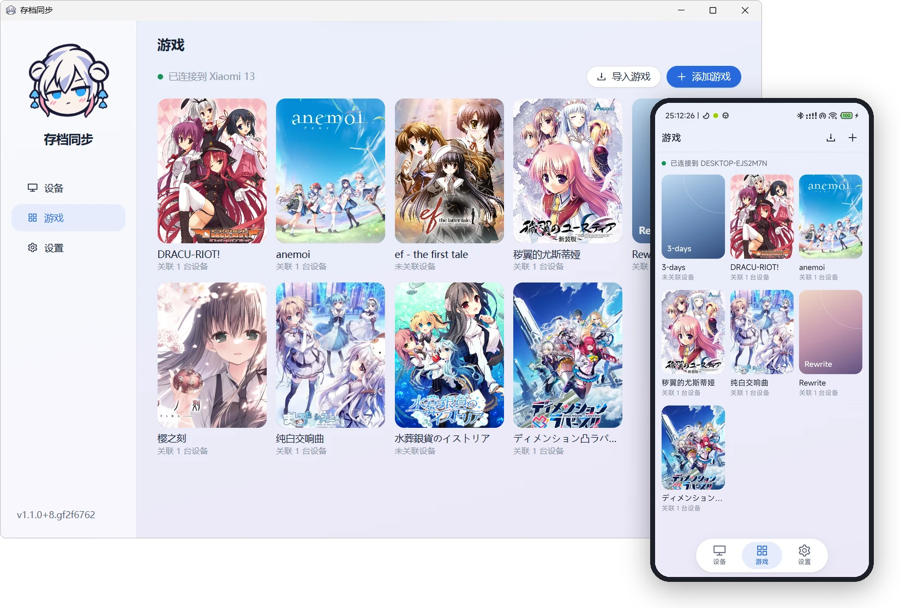
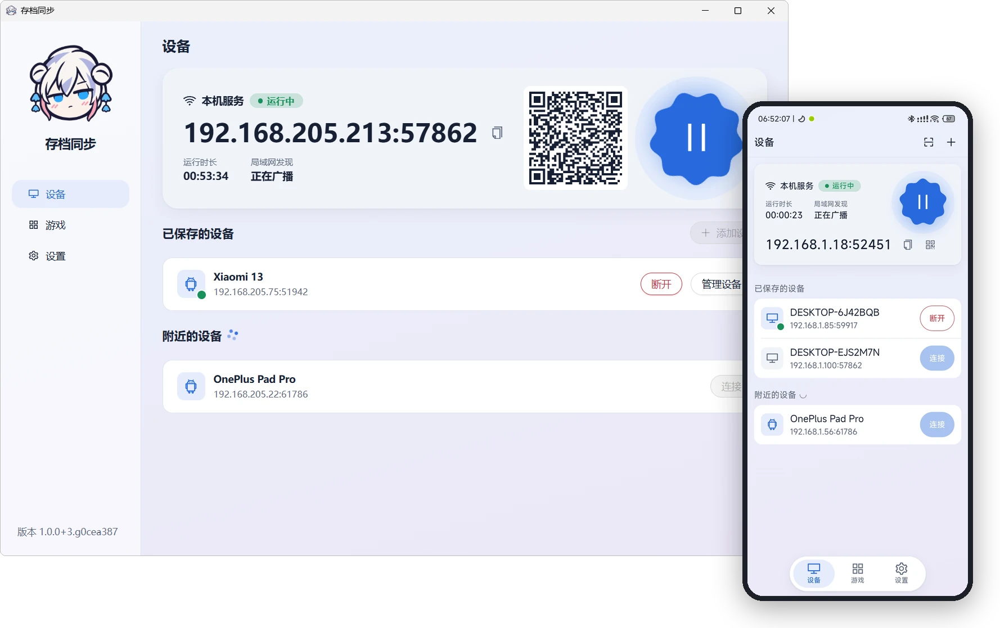
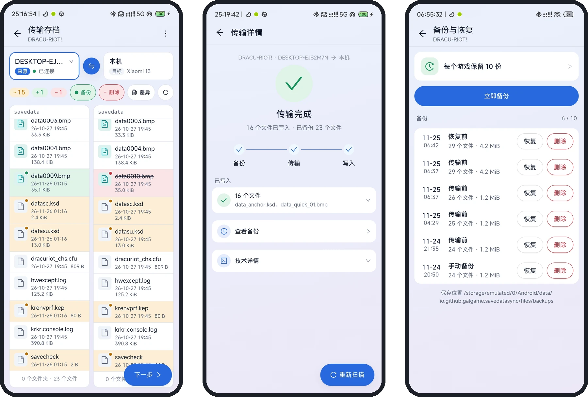

<div align="center">


# Galgame SaveData Sync

LAN save data sync tool for Windows, Linux, and Android

[](https://github.com/Lambholl/galgame-savedata-sync/releases/latest)
[](https://github.com/Lambholl/galgame-savedata-sync/releases)
[](LICENSE)

[中文](README.md) · English

[Download](#download) · [Quick Start](#quick-start) · [Notes](#notes) · [FAQ](#faq) · [Development](docs/development.md)



</div>

## Features

- **Automatic device discovery**: Discovers other devices running the local service on the same LAN, and reconnects automatically if DHCP assigns a new IP address.
- **Game library management**: Manages games and their save folders, with online poster search and game import from a linked device.
- **Backup & restore**: Backs up and restores save folders with one click, or backs up target files automatically before writing.
- **Automatic `.nomedia` creation**: Adds `.nomedia` to save folders on Android so save preview images stay out of the system gallery.

<p align="center">
  
  <br />
  
</p>

## Download

Download the package for your system from [GitHub Releases](https://github.com/Lambholl/galgame-savedata-sync/releases/latest).

| Platform | Requirements | Download |
| --- | --- | --- |
| Windows | Windows 10 or later, x64 | [](https://github.com/Lambholl/galgame-savedata-sync/releases/latest)<br>[](https://github.com/Lambholl/galgame-savedata-sync/releases/latest) |
| Linux | Ubuntu 22.04, Debian 12 or later, x64 | [](https://github.com/Lambholl/galgame-savedata-sync/releases/latest)<br>[](https://github.com/Lambholl/galgame-savedata-sync/releases/latest) |
| Android | Android 11 or later | [](https://github.com/Lambholl/galgame-savedata-sync/releases/latest) |

### Windows Notes

**SmartScreen**: The executable is not digitally signed. If Windows SmartScreen appears, click **More info → Run anyway**.

**WebView2 Runtime**: Pre-installed on Windows 11. The Windows 10 installer downloads it automatically if missing; if the portable build fails to open, install the Microsoft Edge WebView2 Runtime first.

### Linux Notes

**AppImage**: Make the file executable (`chmod +x SavedataSync-<version>-linux-amd64.AppImage`) before running. Requires FUSE 2:

- On Ubuntu 22.04 and Debian 12, run `sudo apt install libfuse2` (on newer distributions, the package is `libfuse2t64`).
- Without FUSE 2, run with `APPIMAGE_EXTRACT_AND_RUN=1`.

**deb package**: Install with `sudo apt install ./SavedataSync-<version>-linux-amd64.deb`, which installs the required system dependencies automatically.

### Portable Mode

**Disabled by default**: Both the Windows portable build and the Linux AppImage share the system user data directory with the installed builds by default and do not store data in the program directory.

**How to enable**: Create a `portable_data` folder next to `SavedataSync.exe` or the `.AppImage` file before launching to store all data inside it (not supported by the Windows installer or Linux deb package).

**Data migration**: Enabling portable mode does not move existing data; add your games and devices again.

### Version Compatibility & Upgrades

Starting from `1.0.0`, upgrading keeps your game settings, device links, and backups. Compatibility across version segments:

| Version segment | Changes | Cross-device compatibility |
| --- | --- | --- |
| Patch (`1.0.x`) | Bug fixes | Different patch versions within the same minor version can connect |
| Minor (`1.x.0`) | New features and storage format upgrades | If the sync protocol changed, update both devices to connect |
| Major (`x.0.0`) | Breaking changes that cannot be migrated automatically | Follow the release notes for that version |

## Quick Start

1. **Connect devices**: Connect both devices to the same Wi-Fi network (or use a mobile hotspot from one device). Start the local service on one device, then connect from the other using nearby discovery, QR code scan, or manual address entry. Each device connects to one peer at a time.
2. **Add and link games**: Add the game and choose its save folder on both devices, then link the matching game on the other device in **Game settings**.
3. **Preview and transfer**: Quit the game before starting a transfer, check the transfer direction and diff list, and start. Extra files in the target folder are kept by default; switch to delete on the preview screen if you want the target folder to match the source.

## Notes

**Backup before writing is off by default**: To keep overwritten files, turn on **Back up before writing** on the **Transfer plan** screen, or create a manual backup under **Backup & restore**. Up to 10 backups are kept per game by default. Restoring a backup automatically backs up the current save folder first.

**Android direct file access**: By default, Android accesses folders through system folder authorization, which cannot preserve file modified dates on write and causes written files to still appear as different in the next comparison. Turn on **Direct file access** in Settings and grant **All files access** to speed up large save transfers and preserve modified dates.

**Restricted Android system folders**: Android does not allow selecting folders inside `Android/data` or `Android/obb`.

**`.nomedia`**: You can place `.nomedia` anywhere in save folders; transfers and backups skip it automatically. On Android, you can enable **Add .nomedia automatically** in Settings. Because other folders inside a game directory may also hold images, placing `.nomedia` in a parent folder is recommended.

**Unencrypted LAN traffic**: Devices communicate over plain HTTP **without encryption or pairing passwords**. Use only on trusted networks such as a home LAN, and stop the local service when finished.

### Data Locations & Uninstalling

Default backup locations can be changed in **Settings**.

| Platform / Mode | Paths | On uninstall or deletion |
| --- | --- | --- |
| Windows<br>(installer & portable default) | UI settings: `%APPDATA%\galgame-savedata-sync`<br>Games & devices: `%LOCALAPPDATA%\galgame-savedata-sync\data`<br>Default backups: `%LOCALAPPDATA%\galgame-savedata-sync\backups` | Keeps data and backups |
| Linux<br>(deb & AppImage default) | UI settings: `~/.config/galgame-savedata-sync`<br>Games & devices: `~/.local/share/galgame-savedata-sync/data`<br>Default backups: `~/.local/share/galgame-savedata-sync/backups` | Keeps data and backups |
| Portable mode<br>(with `portable_data`) | UI settings: `portable_data/config`<br>Games & devices: `portable_data/data`<br>Default backups: `portable_data/backups` | Kept (inside `portable_data`) |
| Android | UI settings & data: App private directory<br>Default backups: `Android/data/io.github.galgame.savedatasync/files/backups/` | **Deletes all settings and backups** |

## FAQ

**Nearby device discovery finds nothing**  
Make sure the other device has the local service running and both devices are on the same network. Check whether your router has guest network isolation ("AP isolation") enabled or a firewall is blocking traffic between devices. You can also connect by scanning the QR code or entering the address manually.

**Version mismatch error**  
Update both devices to the same minor version (for example, both on `1.0.x`).

**Single-transfer limit exceeded**  
A single transfer is limited to 1024 files, 256 MiB per file, and 1 GiB total. When **Back up before writing** is enabled, the target folder must also stay within these limits.

**Insufficient storage space**  
Required space covers both incoming files and pre-write backups. Free up storage space or delete old backups and try again.

**Save folder is no longer valid**  
If the folder was moved, renamed, or had its system permission revoked, choose the save folder again in **Game settings**.

## Build from Source

Requires Node.js 22.13+ and pnpm 10.34.8. Building the desktop app also requires Rust (MSVC toolchain on Windows; WebKitGTK and related development packages on Linux). Building the Android app requires JDK 21 and the Android SDK. See the [Development Guide](docs/development.md) (in Chinese) for full environment setup, signing, and release instructions.

```bash
git clone https://github.com/Lambholl/galgame-savedata-sync.git
cd galgame-savedata-sync
pnpm install
pnpm doctor                     # Check local toolchain
pnpm dev:desktop                # Run desktop app in development mode
pnpm desktop:package            # Package desktop app (Windows installer & portable zip; Linux AppImage & deb)
pnpm android:build              # Build Android debug APK
```

## License

Licensed under [GNU AGPL v3.0](LICENSE).
