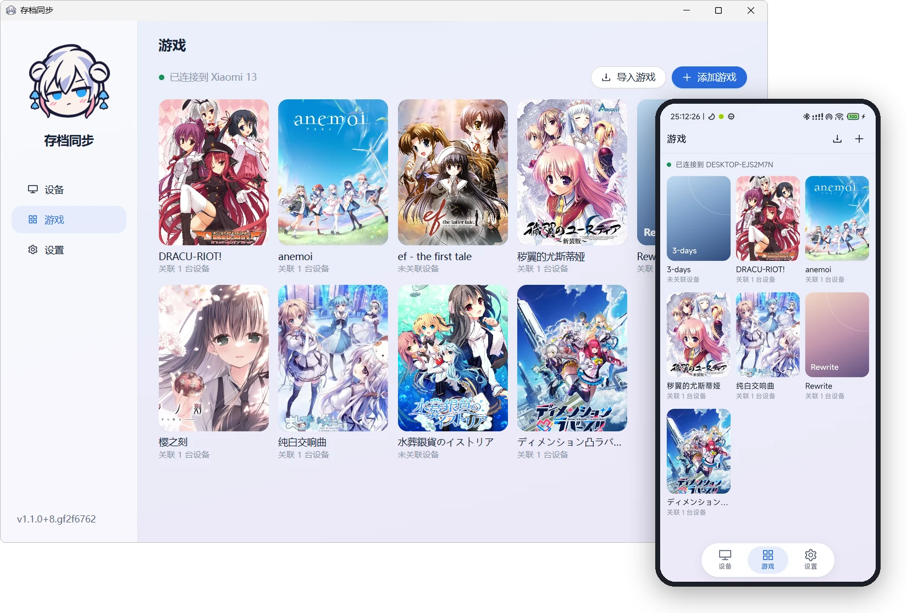

<div align="center">


# Galgame SaveData Sync

Windows、Linux 与 Android 的局域网存档同步工具

[](https://github.com/Lambholl/galgame-savedata-sync/releases/latest)
[](https://github.com/Lambholl/galgame-savedata-sync/releases)
[](LICENSE)

[下载](#下载) · [快速上手](#快速上手) · [注意事项](#注意事项) · [常见问题](#常见问题) · [开发指南](docs/development.md)



</div>

## 特色功能
- **设备自动发现**：可以自动发现局域网中其他开启此 app 服务的设备，DHCP 重新分配 IP 后可自动连接到新地址。
- **游戏库管理**：可以便捷地管理各个游戏，支持封面刮削、从对端导入游戏。
- **备份功能**：支持一键备份/恢复存档。
- **自动添加 .nomedia**：你是否经常出现存档预览图进相册的情况？

<p align="center">
  
  <br />
  
</p>

## 下载

从 [GitHub Releases](https://github.com/Lambholl/galgame-savedata-sync/releases/latest) 下载对应安装包。

| 系统 | 要求 | 下载 |
| --- | --- | --- |
| Windows | Windows 10 及以上，x64 | [](https://github.com/Lambholl/galgame-savedata-sync/releases/latest)<br>[](https://github.com/Lambholl/galgame-savedata-sync/releases/latest) |
| Linux | Ubuntu 22.04、Debian 12 及以上，x64 | [](https://github.com/Lambholl/galgame-savedata-sync/releases/latest)<br>[](https://github.com/Lambholl/galgame-savedata-sync/releases/latest) |
| Android | Android 11 及以上 | [](https://github.com/Lambholl/galgame-savedata-sync/releases/latest) |

### Windows 运行说明

**安全提示**：程序未包含数字签名，SmartScreen 提示时点击“更多信息 → 仍要运行”即可。

**WebView2 运行时**：Windows 11 已自带；Windows 10 安装包会在缺少时自动安装，免安装版若无法打开，请先安装 Microsoft Edge WebView2 运行时。

### Linux 运行说明

**AppImage**：下载后需先添加可执行权限（`chmod +x SavedataSync-<版本>-linux-amd64.AppImage`）再运行。运行依赖 FUSE 2：
  - Ubuntu 22.04、Debian 12 执行 `sudo apt install libfuse2`，较新的发行版包名为 `libfuse2t64`。
  - 未安装 FUSE 2 时，也可设置环境变量 `APPIMAGE_EXTRACT_AND_RUN=1` 后运行。

**deb 安装包**：执行 `sudo apt install ./SavedataSync-<版本>-linux-amd64.deb` 安装，会自动安装所需系统组件。

### 便携模式

**默认不启用**：Windows 免安装版与 Linux AppImage 默认与安装版共用系统用户目录，并不会把数据存放在程序目录内。

**开启方式**：在 `SavedataSync.exe` 或 `.AppImage` 文件同级目录手动新建 `portable_data` 文件夹后启动，才会将数据全部保存在该文件夹内（Windows 安装包与 Linux deb 安装版不支持）。

**数据迁移**：开启便携模式后，已有数据不会自动迁入，需要重新添加。

### 版本兼容与升级

从 `1.0.0` 起，升级新版会保留游戏配置、设备关联与备份。不同版本号之间的兼容规则如下：

| 版本段 | 更新内容 | 两端互通 |
| --- | --- | --- |
| 补丁版（如 `1.0.x`） | 仅修复问题 | 同一次版本下的不同补丁版本可直接互连 |
| 次版本（如 `1.x.0`） | 新增功能，且有配置格式升级 | 若同步协议有调整，两端需同时更新才能连接 |
| 主版本（如 `x.0.0`） | 包含无法自动兼容旧数据的重大变更 | 按对应版本的发布说明处理 |

## 快速上手

1. **连接设备**：将两台设备连入同一 Wi-Fi（或由一台开启移动热点）。在其中一台开启“本机服务”，另一台从发现列表、扫码或手动输入地址发起连接。同一时间每台设备只连接一台对方设备。
2. **添加并关联游戏**：在两端分别添加游戏并选择各自的游戏存档目录，然后在游戏设置中关联对方设备的对应游戏。
3. **预览并传输**：退出正在运行的游戏后发起传输，确认传输方向与差异列表即可开始。目标目录多出的文件默认保留，如需与来源保持完全一致，可在预览页切换为删除。

## 注意事项

**备份默认关闭**：需要保留覆盖前的文件时，请在传输预览页开启“写入前备份”，或在游戏的“备份与恢复”页手动备份。每个游戏默认保留 10 份备份；恢复备份前会自动备份当前目录。

**Android 直接读写文件**：默认通过系统目录授权读写文件，受系统限制写入后无法保留修改时间，导致下次对比时仍会显示文件存在差异。在设置中开启“直接读写文件”并授予“所有文件访问权限”后，可加快大存档读写速度并正确保留修改时间。

**Android 受限系统目录**：受系统限制，无法选择 `Android/data` 和 `Android/obb` 内的目录。

**`.nomedia`**：可以在存档目录自由添加，传输和备份会自动跳过该文件。Android 端可在设置中开启自动添加 `.nomedia`。不过，考虑到游戏中其他文件夹也可能包含图片，建议在父目录就添加。

**局域网明文传输**：设备间通过明文 HTTP 直接通信，**未加密且无配对密码**。请仅在家庭网络等可信环境中使用，使用完毕后建议关闭本机服务。

### 数据位置与卸载

| 平台 / 模式 | 界面设置 | 游戏、设备与默认备份 | 卸载或删除程序 |
| --- | --- | --- | --- |
| Windows（安装版与免安装版默认） | `%APPDATA%\galgame-savedata-sync` | 数据在 `%LOCALAPPDATA%\galgame-savedata-sync\data`，默认备份在同级 `backups`（可在设置中更改） | 保留数据与备份 |
| Linux（deb 与 AppImage 默认） | `~/.config/galgame-savedata-sync` | 数据在 `~/.local/share/galgame-savedata-sync/data`，默认备份在同级 `backups`（可在设置中更改） | 保留数据与备份 |
| 开启便携模式（自建 `portable_data` 后） | `portable_data/config` | 数据在 `portable_data/data`，默认备份在 `portable_data/backups`（可在设置中更改） | 保留（随 `portable_data` 目录） |
| Android | 应用私有目录 | 备份在 `Android/data/io.github.galgame.savedatasync/files/backups/` | **一并删除所有配置与备份** |

## 常见问题

**无法自动发现对方设备**  
确认对方已开启本机服务且两台设备处于同一网络，并排查路由器的访客网络、“AP 隔离”或系统防火墙是否拦截了设备间通信；若仍无法自动发现，可直接扫码或手动输入地址连接。

**提示版本不同**  
请将两台设备更新至同一 minor 版本（例如均为 `1.0.x`）。

**提示超出单次传输限制**  
单次传输上限为 1024 个文件、单文件不超过 256 MiB、总体积不超过 1 GiB；开启写入前备份时，目标目录也需满足同一上限。

**提示空间不足**  
写入所需空间包含待写入文件与写入前备份，请清理存储空间或旧备份后重试。

**提示存档目录已失效**  
若原目录被移动、重命名或访问授权被系统收回，请在游戏设置中重新选择存档目录。

## 从源码构建

需要 Node.js 22.13+ 和 pnpm 10.34.8；构建桌面端还需 Rust（Windows 上用 MSVC 工具链，Linux 上另需 WebKitGTK 等开发包），构建 Android 版还需 JDK 21 和 Android SDK。完整环境说明、签名与发布流程见[开发指南](docs/development.md)。

```bash
git clone https://github.com/Lambholl/galgame-savedata-sync.git
cd galgame-savedata-sync
pnpm install
pnpm doctor                     # 检查本机开发工具
pnpm dev:desktop                # 运行桌面端开发版
pnpm desktop:package            # 打包桌面端：Windows 上产出安装包与免安装版，Linux 上产出 AppImage 与 deb
pnpm android:build              # 构建 Android debug APK
```

## 许可证

本项目采用 [GNU AGPL v3.0](LICENSE) 许可。
