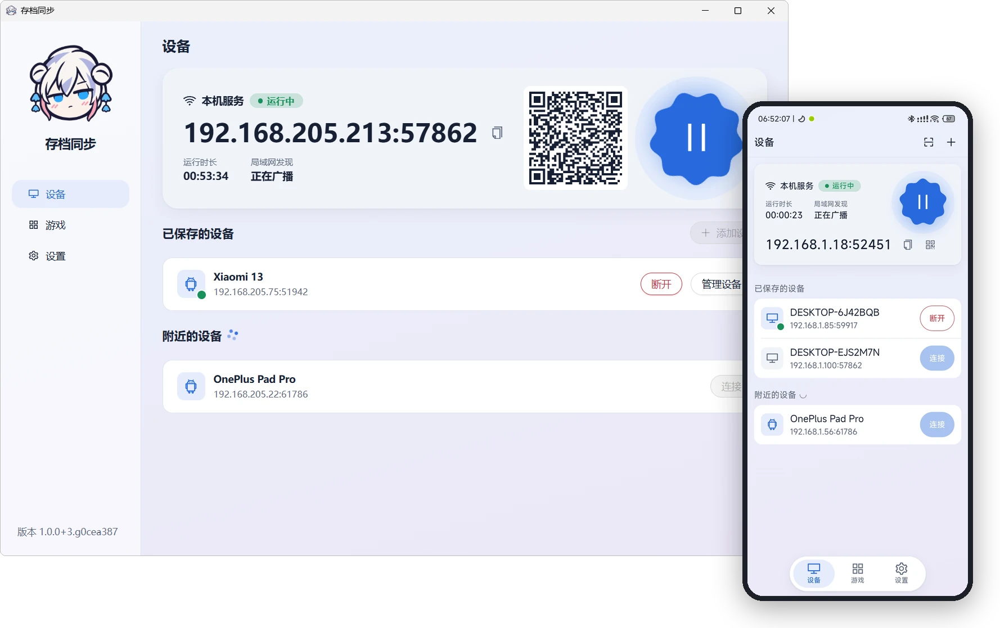
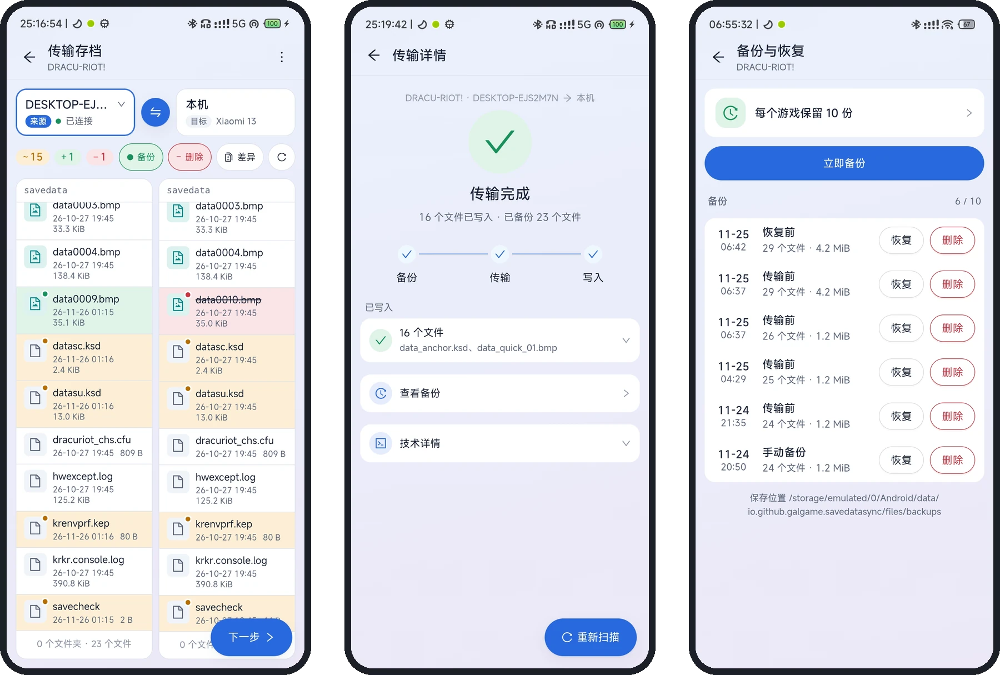

<div align="center">


# Galgame SaveData Sync

Windows 与 Android 的局域网存档同步工具。

[](https://github.com/Lambholl/galgame-savedata-sync/releases/latest)
[](https://github.com/Lambholl/galgame-savedata-sync/releases)
[](LICENSE)

[下载](#下载) · [快速上手](#快速上手) · [注意事项](#注意事项) · [常见问题](#常见问题) · [开发指南](docs/development.md)


</div>

## 功能

- **局域网直连**：同一网络下任意两台设备（Windows 或 Android）直接传输文件，不经过云端，无需账号。
- **传输前预览差异**：对比两端当前存档目录，列出待新建、覆盖和保留/删除的文件，确认后再写入。
- **备份与恢复**：支持按次在写入前备份目标目录，或随时手动备份，出错时可恢复到任意历史备份。
- **多种连接方式**：支持局域网自动发现、扫描二维码（移动端）与手动输入地址；对端更换 IP 后可自动重连。
- **后台保活**：Android 端切至后台后，已开启的本机服务与进行中的传输会在通知栏保活。
- **免费开源**：采用 [GNU AGPL v3.0](LICENSE) 许可。

<p align="center">
  
  <br />
  
</p>

## 下载

从 [GitHub Releases](https://github.com/Lambholl/galgame-savedata-sync/releases/latest) 下载对应安装包，页面同时提供用于校验完整性的 `SHA256SUMS.txt`。

| 平台 | 文件 | 说明 |
| --- | --- | --- |
| Windows 10+ | `SavedataSync-<版本>-Setup-x64.exe` | 64 位安装包，支持只为当前用户或所有用户安装 |
| Windows 10+ | `SavedataSync-<版本>-Portable-x64.zip` | 64 位免安装版，解压后运行 `SavedataSync.exe` |
| Android 11+ | `SavedataSync-<版本>-Android.apk` | 安装时按系统提示允许安装来自该来源的应用 |

**Windows 运行提示与 WebView2**  
程序未包含数字签名，SmartScreen 提示时点击“更多信息 → 仍要运行”即可。Windows 11 已自带 WebView2 运行时；Windows 10 安装包会在缺少时自动安装，使用免安装版若无法打开，请先安装 Microsoft Edge WebView2 运行时。

**免安装版便携模式**  
默认与安装版共用用户目录（界面设置位于 `%APPDATA%\galgame-savedata-sync`，游戏、设备和备份位于 `%LOCALAPPDATA%\galgame-savedata-sync`），卸载或删除程序不会删除这些数据。如需将数据随程序保存，在 `SavedataSync.exe` 同级目录新建 `portable_data` 文件夹即可；已有数据不会自动迁入，需要重新添加。

**版本兼容与升级**  
1.0 起升级新版会保留游戏配置、设备关联与备份；两台设备需处于同一主次版本（例如均为 `1.0.x`）才能连接。从 `0.x` 测试版升级到 `1.0` 时旧配置与目录登记不迁移，首次启动会重置，需要重新添加游戏和设备（Android 端如需保留 `0.x` 备份，请在升级前先自行导出）。

## 快速上手

1. **连接设备**：将两台设备连入同一 Wi-Fi（或由一台开启移动热点）。在其中一台开启“本机服务”，另一台从发现列表、扫码或手动输入地址发起连接。同一时间每台设备只连接一台对端设备。
2. **添加并关联游戏**：在两端分别添加游戏并选择各自的游戏存档目录，然后在游戏设置中关联对端设备的对应游戏。
3. **预览并传输**：退出正在运行的游戏后发起传输，确认传输方向与差异列表即可开始。目标目录多出的文件默认保留，如需与来源保持完全一致，可在预览页切换为删除。

## 注意事项

- **备份默认关闭**：需要保留覆盖前的文件时，请在传输预览页开启“写入前备份”，或在游戏的“备份与恢复”页手动备份。每个游戏默认保留 10 份备份（可在设置中修改，上限 4096 份）；恢复前同样会自动备份当前目录。
- **备份位置与卸载**：桌面端备份默认位于 `%LOCALAPPDATA%\galgame-savedata-sync\backups`（Windows）或 `~/.local/share/galgame-savedata-sync/backups`（Linux），可在设置中更改位置，卸载不删除；移动端备份位于 `Android/data/io.github.galgame.savedatasync/files/backups/`，**卸载应用或清除应用数据会一并删除所有配置与备份**。
- **Android 直接读写文件**：默认通过系统目录授权读写文件，受系统限制写入后无法保留修改时间，导致下次对比时仍会显示文件存在差异。在设置中开启“直接读写文件”并授予“所有文件访问权限”后，可加快大存档读写速度并正确保留修改时间。受 Android 系统限制，无法选择 `Android/data` 和 `Android/obb` 内的目录。
- **避免相册收录存档截图**：若存档目录中包含游戏截图，可在 Android 端设置中开启“自动添加 `.nomedia`”（传输和备份会自动跳过该文件）。
- **局域网明文传输**：设备间通过明文 HTTP 直接通信，**未加密且无配对密码**。请仅在家庭网络等可信环境中使用，使用完毕后建议关闭本机服务。

## 常见问题

**找不到对方设备**  
确认对端已开启本机服务且两台设备处于同一网络，并排查路由器的访客网络或“AP 隔离”是否拦截了设备间通信；若受防火墙或网络环境影响无法自动发现，可直接扫码或手动输入地址连接。

**提示版本不同**  
请将两台设备更新至同一主次版本（例如均为 `1.0.x`）。

**提示超出单次传输限制**  
单次传输上限为 1024 个文件、单文件不超过 256 MiB、总体积不超过 1 GiB；开启写入前备份时，目标目录也需满足同一上限。

**提示空间不足或存档目录已失效**  
写入所需空间包含待写入文件与写入前备份，请清理存储空间或旧备份后重试；若原目录被移动、重命名或访问授权被系统收回，请在游戏设置中重新选择存档目录。

## 从源码构建

需要 Node.js 22.13+ 和 pnpm 10.34.8；构建 Windows 版还需 Rust（MSVC 工具链），构建 Android 版还需 JDK 21 和 Android SDK。完整环境说明、签名与发布流程见[开发指南](docs/development.md)。

```bash
git clone https://github.com/Lambholl/galgame-savedata-sync.git
cd galgame-savedata-sync
pnpm install
pnpm doctor                     # 检查本机开发工具
pnpm dev:desktop                # 运行 Windows 开发版
pnpm desktop:package            # 打包 Windows 安装包与免安装版
pnpm android:build              # 构建 Android debug APK
```

## 许可证

本项目采用 [GNU AGPL v3.0](LICENSE) 许可。
